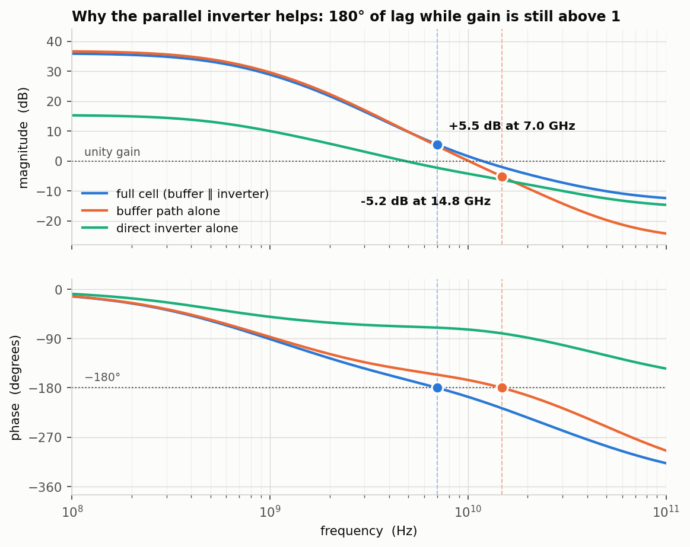
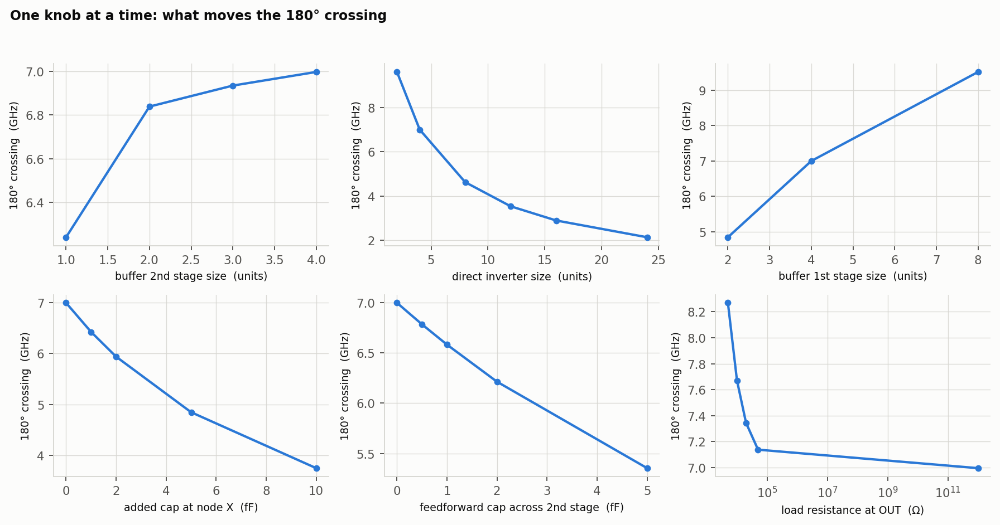
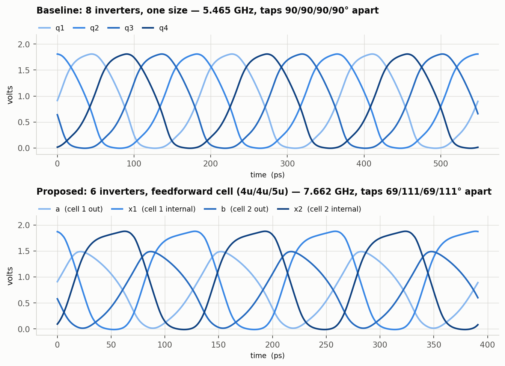
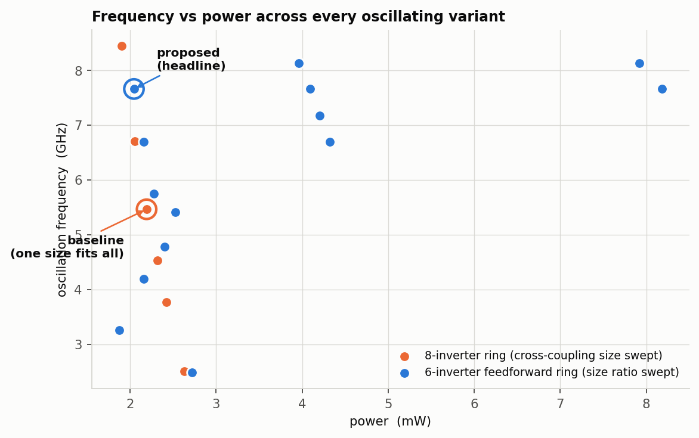

# Feedforward quadrature ring oscillator in SkyWater sky130

A **buffer in parallel with a single inverter** gives a stage 180° of phase lag *while its
gain is still above 1*. Two of those cells close a 6-inverter ring that oscillates **40%
faster on less power and 25% fewer inverters** than the conventional 8-inverter quadrature
ring — and gives that back in quadrature accuracy.

Everything is simulated in **ngspice 46** against the **sky130A** PDK. Every number in this
README is generated from the raw sweeps by `scripts/make_readme.py`; nothing is typed in by hand.

> **On the process node.** This was asked for as *"SkyWater 180 nm"*. SkyWater's open PDK is
> **130 nm** — `sky130A`, 1.8 V core devices — and no open SkyWater 180 nm process exists. The
> design brief itself specifies sky130 primitives, so sky130A is used throughout.

## Headline comparison

| | Baseline — 8 inverters, one size fits all | Proposed — 6 inverters, feedforward cell | Δ |
|---|---|---|---|
| **Oscillation frequency** | **5.465 GHz** | **7.662 GHz** | **+40%** |
| Inverter count | 8 | 6 | −25% |
| Sizing | all 8 at 4u | buf1 4u / buf2 4u / inv 5u | — |
| Total unit devices | 32u | 26u | −19% |
| Power @ 1.8 V | 2.192 mW | 2.045 mW | −7% |
| Efficiency | 2.49 GHz/mW | 3.75 GHz/mW | +51% |
| Phase spacing of the 4 taps | 90/90/90/90° | 69/111/69/111° | — |
| **Quadrature error** | **0.0°** | **21.3°** | **worse** |
| Period jitter (numerical) | 0.001% | 0.001% | — |
| Self-starts from a supply ramp | yes | yes | — |

**The trade.** The feedforward cell buys +40% frequency, 7% lower power, 19% fewer
devices and two fewer inverters — and pays for it in phase accuracy: the baseline's four taps
sit at exactly 90°, the proposed ring's at 69/111/69/111°. Need true quadrature, take the
8-inverter ring. Need a fast, small, low-power 4-phase clock and can tolerate (or calibrate out)
a fixed phase error, the 6-inverter cell wins on every other axis.

### Two caveats that belong next to that table

1. **A *sized* 8-inverter ring beats both.** Holding "one size fits all" is what costs the
   baseline its speed. Weakening just the cross-coupled inverters (forward 4u, cross 2u) takes the
   8-inverter ring to **8.446 GHz at 1.900 mW with 0.0° error**
   (4.44 GHz/mW) — faster, cooler *and* perfectly quadrature. The honest
   claim is that the feedforward cell beats an *unsized* baseline, not that it beats the topology.
2. **The 6-inverter ring only works in a narrow sizing window.** 16 of the 30 swept
   6-inverter variants latch instead of oscillating. The window is a ratio condition, described below.



## Why the parallel inverter helps

Node `IN` drives two paths onto a shared node `OUT`: a **buffer** (two inverters in series, via
internal node `X`) and a **single inverter**. Writing the two transconductance paths into the
shared output impedance:

```
            R_out · ( gm1·gm2·R_x − gm3 − s·gm3·R_x·C_x )
H(s)  =  ------------------------------------------------
                 (1 + s·R_out·C_out) (1 + s·R_x·C_x)
```

Two poles, and a zero at `s = +(gm1·gm2·R_x − gm3)/(gm3·R_x·C_x)` — a **right-half-plane zero**
whenever the buffer path wins at DC. An RHP zero contributes *phase lag like a pole but gain
rise like a zero*. That is the whole trick: the cell reaches 180° without paying the usual
magnitude penalty for the extra lag.

The decomposition run measures it directly (TT, each path driven alone while **both** output
devices stay connected so `Z_out` is identical in every configuration):

| Path | DC gain | reaches −180° at | gain left there | can sustain a 2-stage ring? |
|---|---|---|---|---|
| buffer ∥ inverter (the cell) | 36.00 dB | 6.996 GHz | 5.50 dB | yes |
| buffer alone | 36.77 dB | 14.837 GHz | −5.17 dB | no |
| single inverter alone | 15.38 dB | never | — | n/a |

That is the result the whole design rests on. The plain buffer does eventually reach 180°, but
only at **2.1× higher frequency, by which point it has lost 5.2 dB** — a two-stage ring of plain
buffers cannot oscillate. The cell reaches 180° with **+5.5 dB in hand**, so two of them can.

## Knob sweeps



Each knob moved one at a time from the nominal cell, TT corner:

| Knob | Range | 180° crossing | Direction | Brief predicted | Matches? |
|---|---|---|---|---|---|
| Buffer 2nd stage **shrunk** | 4u → 1u | 7.00 → 6.24 GHz | falls | rises | **no** |
| Direct inverter **grown** | 2u → 24u | 9.60 → 2.14 GHz | falls | rises | **no** |
| Buffer 1st stage grown | 2u → 8u | 4.84 → 9.51 GHz | rises | rises | yes |
| Added cap at node X | 0 → 10 fF | 7.00 → 3.75 GHz | falls | falls | yes |
| Feedforward cap across 2nd stage | 0 → 5 fF | 7.00 → 5.35 GHz | falls | falls | yes |
| Load resistance at OUT lowered | 1 TΩ → 5 kΩ | 7.00 → 8.27 GHz | rises | rises | yes |
| Load resistance at X lowered | 1 TΩ → 5 kΩ | 7.00 → 9.10 GHz | rises | rises | yes |

**Two of the brief's predictions came out backwards**, and the reason is the same in both cases:
the brief treated the knobs as if they only moved a capacitance, but in a CMOS inverter the same
device sets both `gm` and `C`.

- *Shrinking the buffer's second stage* was expected to raise the crossing by cutting `C_x`. It
  **lowers** it (7.00 → 6.24 GHz), because shrinking that inverter cuts `gm2` — weakening the very
  path whose imbalance against `gm3` places the zero — faster than it cuts `C_x`.
- *Growing the direct inverter* was expected to raise the crossing. It **lowers** it sharply
  (7.00 → 2.14 GHz at 24u): a larger `gm3` moves the RHP zero *down* in frequency, since the zero
  sits at `gm1·gm2/(gm3·C_x) − 1/(R_x·C_x)`.

The knobs that genuinely raise the crossing are **a bigger buffer first stage** (4.84 → 9.51 GHz),
**less capacitance at X**, and **lower load resistance** (which trades away DC gain, exactly as the
brief predicted for that one).

### The magnitude notch does not exist

The brief expected a magnitude null where the two paths cancel (`A = 1`), with the 180° crossing
just below it. **No local magnitude minimum appears in any of the 44 variants** over 1 kHz–100 GHz.

The naive argument is that the buffer path tracks `A²` and the inverter path tracks `A`, so they
cancel when `|A| = 1`. They do reach equal magnitude — around 16 GHz at TT — but by then the
buffer path has accumulated a second pole's worth of extra phase, so the two contributions are
roughly **90° apart rather than 180°**. They add in quadrature instead of cancelling. What
survives of the cancellation is not a null but the RHP zero, which is what the design actually uses.

## Ring oscillator results





Startup is modelled honestly: every variant gets its own supply ramped 0 → 1.8 V over 100 ps and a
single 10 ps / 20 µA pulse to break symmetry. Nothing is forced with `.ic`, so a variant counts as
oscillating only if it **self-starts**.

### Only the size ratio matters

Frequency and phase spacing depend on the **ratio** `buf1 : buf2 : inv`, not on absolute size —
absolute size only sets power. Identical ratios land on identical results:

| Sizing (units) | Ratio | Frequency | Quadrature error | Power |
|---|---|---|---|---|
| 4 / 4 / 5 | 4:4:5 | 7.662 GHz | 21.3° | 2.045 mW |
| 8 / 8 / 10 | 4:4:5 | 7.662 GHz | 21.3° | 4.090 mW |
| 16 / 16 / 20 | 4:4:5 | 7.662 GHz | 21.3° | 8.182 mW |
| 4 / 4 / 6 | 2:2:3 | 6.699 GHz | 26.7° | 2.161 mW |
| 8 / 8 / 12 | 2:2:3 | 6.699 GHz | 26.7° | 4.321 mW |
| 8 / 8 / 9 | 8:8:9 | 8.131 GHz | 18.6° | 3.958 mW |
| 16 / 16 / 18 | 8:8:9 | 8.131 GHz | 18.6° | 7.918 mW |

`4/4/5` and `16/16/20` are the same 4:4:5 ratio and give the same frequency and phase error at 4×
the power; `8/8/9` and `16/16/18` likewise. So the design has **one free knob for speed and phase**
(the ratio) and **one independent knob for power** (the absolute size) — a genuinely useful property.

### The oscillation window

The ring oscillates only when the direct inverter is **slightly larger** than the buffer's second
stage. At a ratio of exactly 1:1 it latches; the usable window is roughly **1.12 ≤ inv/buf2 ≤ 2.5**,
and the best results sit right against the lower edge:

| inv / buf2 ratio | Frequency | Quadrature error |
|---|---|---|
| 1.000 | latches | — |
| 1.062 | latches | — |
| 1.125 | 8.131 GHz | 18.6° |
| 1.250 | 7.662 GHz | 21.3° |
| 1.375 | 7.179 GHz | 24.0° |
| 1.500 | 6.699 GHz | 26.7° |
| 1.750 | 5.746 GHz | 32.4° |
| 2.000 | 4.778 GHz | 38.7° |
| 2.500 | 2.489 GHz | 56.4° |
| 3.000 | latches | — |
| 4.000 | latches | — |

Pushing the ratio toward 1 raises frequency *and* improves quadrature, right up until the ring
latches — the optimum sits on the edge of a cliff, which is a real robustness concern for a design
that has to survive process variation.

## Process corners

Baseline cell, SS / TT / FF:

| Corner | Inverter trip point | Cell reaches −180° at | Gain there | Buffer reaches −180° at | Gain there |
|---|---|---|---|---|---|
| TT | 0.8693 V | 6.996 GHz | 5.50 dB | 14.837 GHz | −5.17 dB |
| SS | 0.8949 V | 3.185 GHz | 4.99 dB | 6.677 GHz | −5.40 dB |
| FF | 0.8430 V | 11.733 GHz | 5.39 dB | 24.337 GHz | −5.16 dB |

The crossing itself moves a lot — **3.7× from SS to FF** — which is ordinary for a ring oscillator
and is why real ones are tuned or locked. The important part is that **the mechanism is corner-
invariant**: the cell holds ~+5 dB at its 180° crossing in every corner while the plain buffer is
~−5 dB in every corner. The architectural claim does not depend on the corner.

Both oscillators across corners:

| Corner | 8-inverter baseline | 6-inverter proposed |
|---|---|---|
| TT | 5.465 GHz, 0.0° err | 7.662 GHz, 21.3° err |
| SS | 3.899 GHz, 0.0° err | 5.328 GHz, 17.3° err |
| FF | 7.069 GHz, 0.0° err | 10.106 GHz, 25.6° err |

The frequency advantage holds in **every corner** (+37% to +43%),
and both rings self-start in all three. So the speed-up is a property of the topology,
not of a lucky nominal operating point — which is the result that makes the cell worth
considering despite the phase error.

## What did not work

Recorded because negative results are the expensive part of this kind of study:

- **The magnitude notch does not exist** (above). The cancellation shows up as an RHP zero, not a null.
- **Two of the brief's four sizing predictions came out backwards** (above), because sizing an
  inverter moves `gm` and `C` together.
- **The naive 6-inverter ring latches.** With all three inverters the same size, two cells in a
  loop form a DC-non-inverting loop with large positive loop gain and two stable latch states. It
  needs the direct inverter deliberately oversized to break them.
- **A plain 8-inverter ring (4 buffer stages) also latches** and is not a usable baseline; the
  working 8-inverter quadrature ring needs the cross-coupled anti-phase inverters used here.
- **The 6-inverter ring never reaches true quadrature.** Across every variant swept, the best
  phase error is 18.6°. The four taps are two antipodal pairs
  (`a`,`b` and `x1`,`x2`); where the internal node `X` falls between the cell outputs is set by the
  buffer's internal delay split, and in sky130 it never lands on 90°.

## Reproduce

```sh
export PDK_ROOT=$HOME/.volare      # the directory CONTAINING sky130A
./scripts/run_all.sh
```

Needs `ngspice` (tested on 46), Python 3 with `numpy` + `matplotlib`, and an open_pdks/volare
`sky130A` install. The full set is 7 ngspice invocations and a few minutes; every variant of a
given analysis is packed into a single netlist because loading the sky130 models costs ~40 s per
invocation on its own.

### Cross-check

The post-processing is checked against ngspice's own `meas` command by a 20-line standalone
netlist, `spice/demo_cell_ac.sp`, which needs nothing from the Python at all:

```
$ ngspice -b spice/demo_cell_ac.sp
f180_cell    = 6.99770e+09      gain_cell   =  5.49517e+00
f180_buffer  = 1.48404e+10      gain_buffer = −5.17331e+00
```

Those agree with the table above to four significant figures, from a completely separate
measurement path.

## Two sky130 traps worth knowing

Both silently produced wrong answers before being caught, and both are documented in `spice/common.sp`:

1. **Never name a subcircuit parameter `M`.** SPICE reserves `m` on an instance line as the
   multiplicity factor, so `X1 a b inv M=4` is swallowed as a multiplier and never reaches your
   devices. The sweep runs happily and every variant returns identical numbers. This knob is `SZ`.
2. **sky130 FET models are width-binned to discrete values.** An arbitrary `W` (0.35 µm, say) fails
   with `could not find a valid modelname`. Sizing here pins `W` to a legal bin and scales with the
   device multiplier `m`, which was verified to scale drain current exactly (`m=4` → 4.000×).

## Layout

```
spice/common.sp        inverter, feedforward cell, both ring oscillators, trip-point generator
spice/demo_cell_ac.sp  standalone 20-line reproduction of the headline result
scripts/gen_ac.py      emits one netlist holding all 44 AC variants + manifest
scripts/gen_osc.py     emits one netlist holding all 37 oscillator variants + manifest
scripts/acmetrics.py   unwrapped phase, interpolated crossings, notch detection
scripts/oscmetrics.py  frequency, phase spacing and jitter from transient waveforms
scripts/analyze.py     raw sweeps -> results/*.csv
scripts/plots.py       results -> docs/*.png
scripts/make_readme.py results -> this README
scripts/run_all.sh     end-to-end reproduction
results/*.csv          every measured number, per corner
```

## License

MIT — see [LICENSE](LICENSE).
